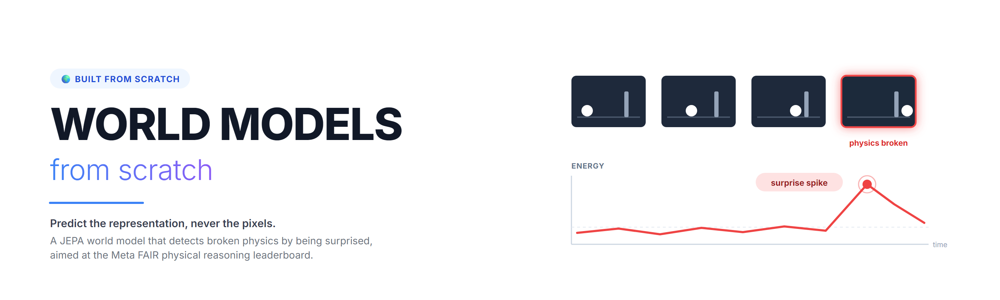
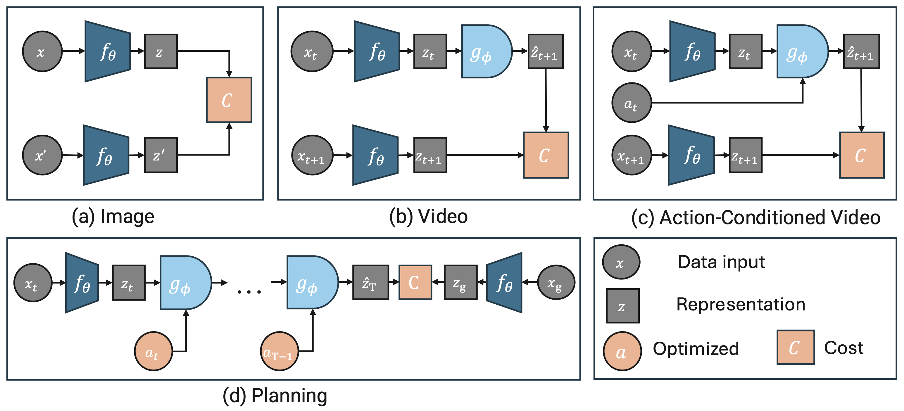
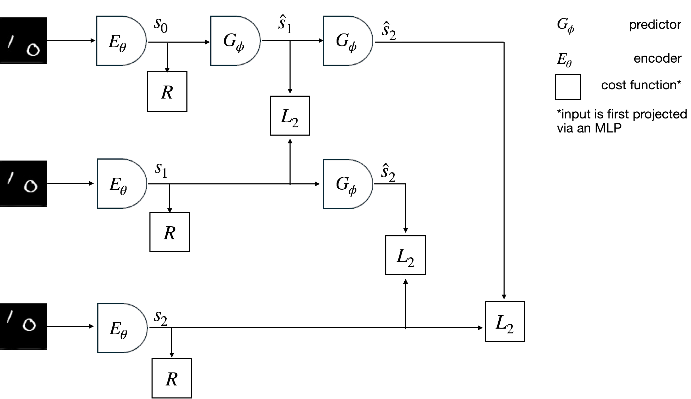
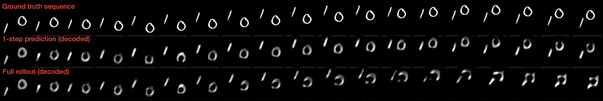
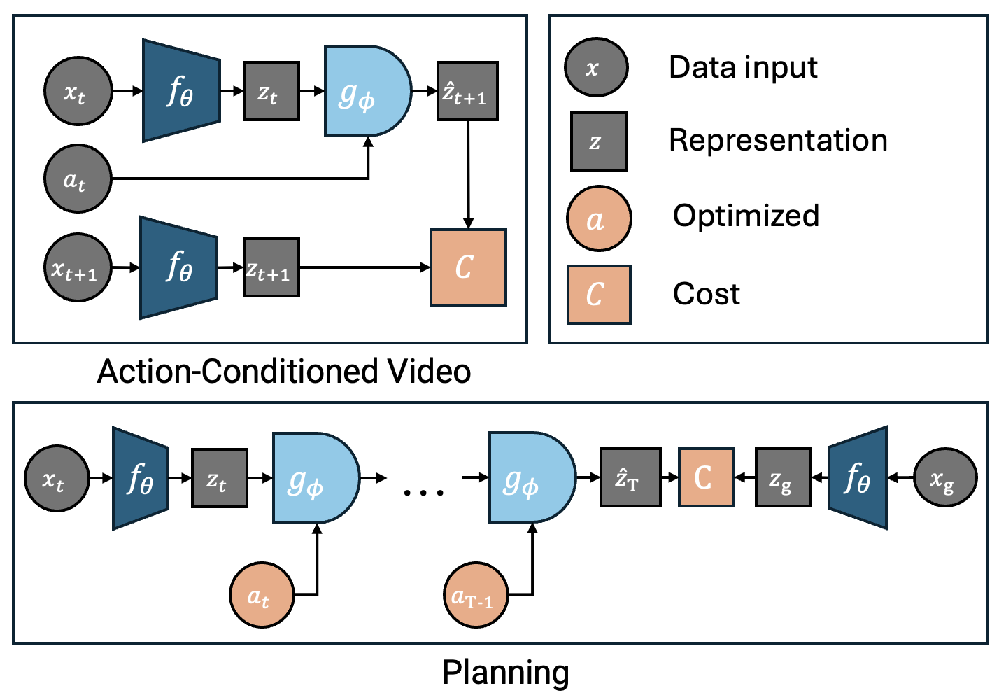
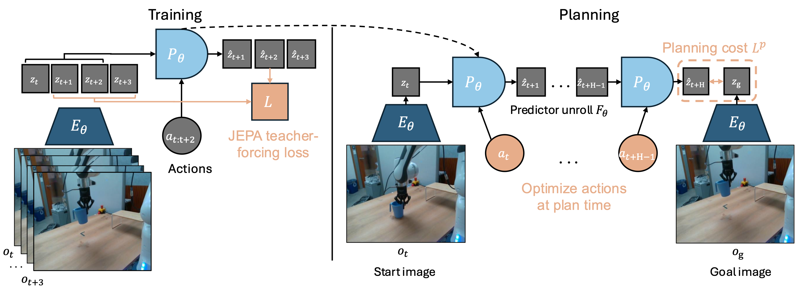
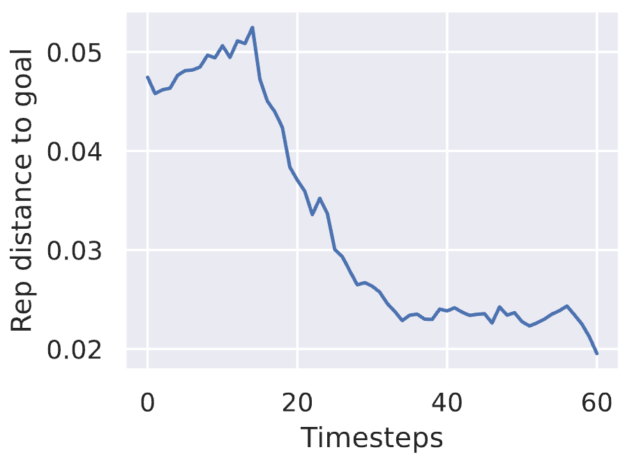
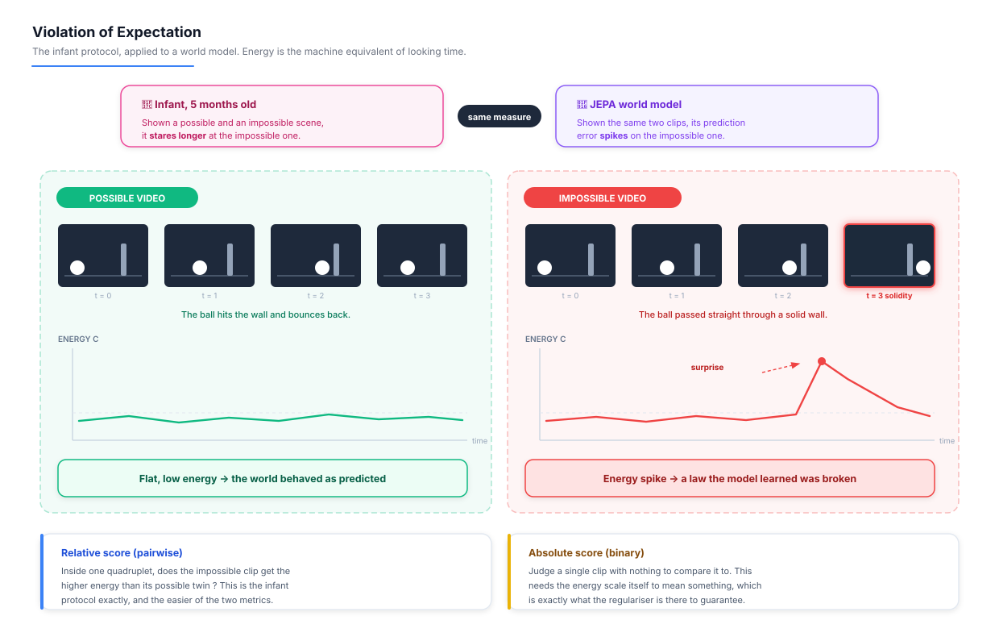
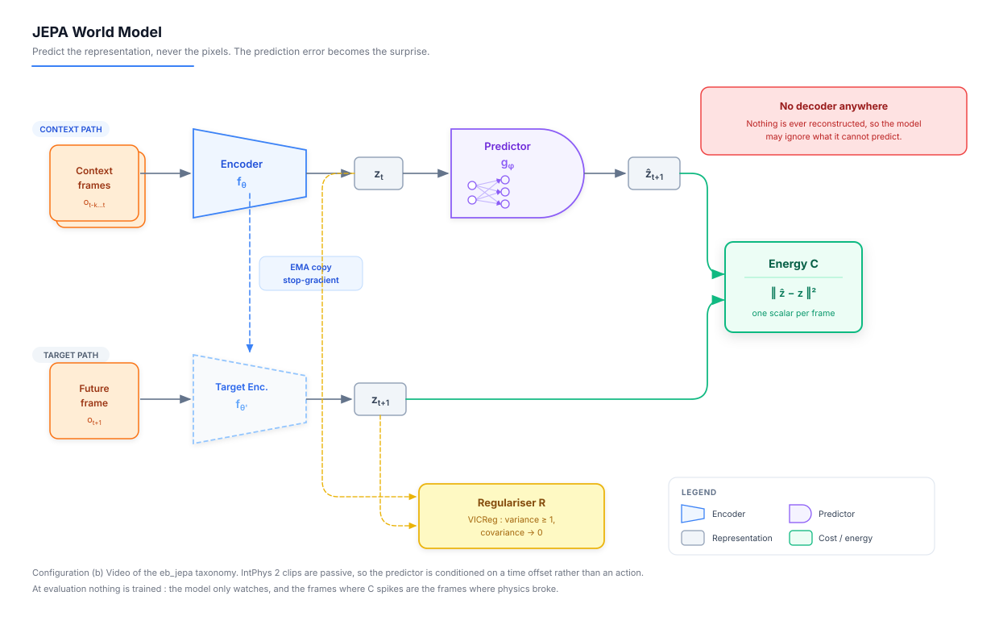

# 🌍🧠 World Models from Scratch


<p align="center">
  
</p>

## 📝 Project Description

Welcome to **World Models from Scratch** 🌍🧠 !

A **world model** is a neural network that learns the **dynamics** of an environment, so a machine can *imagine* what happens next instead of only reacting to what it sees. It is the piece that separates an agent that answers from an agent that **understands**.

This repository does two things. It **explains the field** using the reference figures published by **Meta FAIR**, and it **builds one architecture from scratch** to take it to a public leaderboard.

The architecture built here is a **JEPA (Joint-Embedding Predictive Architecture)**, the non-generative branch of the field pushed by Yann LeCun. It never draws a single pixel. It predicts **representations**, and the error of that prediction becomes a measure of **surprise**.

This repo is the world model counterpart of my [Language Models from Scratch](https://github.com/Thibault-GAREL/Language_Models) 📚

---

## 🎯 The Goal

> **Can a small model, trained from scratch, be surprised by broken physics ?**

Meta FAIR maintains the [**Physical Reasoning from Video leaderboard**](https://huggingface.co/spaces/facebook/physical_reasoning_leaderboard) on Hugging Face. It tracks three benchmarks, and the one targeted here is [**IntPhys 2**](https://github.com/facebookresearch/IntPhys2).

IntPhys 2 shows a model **quadruplets of videos**, two where physics holds and two where it breaks (an object vanishes behind a wall, passes through a solid, changes colour mid-flight). The model must say which ones are impossible. It is the exact protocol developmental psychologists use on infants, called **violation of expectation**.

The state of the field on this benchmark :

| | IntPhys 2 accuracy |
|---|---|
| 🧑 **Humans** | near perfect |
| 🤖 **Current video models and VLMs** | **~50 %, pure chance** |

Frontier multimodal models, with billions of parameters, **cannot tell a possible video from an impossible one**. That is the gap this project aims at.

**The bet :** understanding physics does not require knowing how to *draw* the world, it requires knowing how to be **surprised** by it. A JEPA predicts in representation space, so a broken law of physics makes its prediction error explode. V-JEPA already proved the principle by reaching **98 % on IntPhys v1** with no task-specific training at all ([Garrido, Ballas & LeCun, 2025](https://arxiv.org/abs/2502.11831)). IntPhys 2 is the hard version of that test, and it is still open.

**Success criterion :** a verified entry on the Meta FAIR leaderboard, above chance on the held-out split. The held-out answers are private, so a score there **cannot be self-declared**, it has to be earned through submission.

---

## ⚙️ Features

  🌍 **The field explained through its reference figures** : the diagrams from `eb_jepa` and `jepa-wms`, read one by one, each carrying one idea

  🧠 **A JEPA world model built from scratch** : encoder, predictor, EMA target, and the anti-collapse regulariser, no library shortcut

  🎬 **A generated pretraining corpus** : the benchmark forbids training on itself, so physics is learned on videos produced here by a physics engine

  ⚡ **Energy as the single output** : the model returns one number per frame, the incompatibility between what it expected and what happened

  👁️ **Violation of expectation scoring** : IntPhys 2 quadruplets ranked by surprise, both in relative (pairwise) and absolute (binary) mode

  🏆 **Leaderboard submission pipeline** : JSONL export in the exact format Meta FAIR expects (`data_name`, `task`, `row_id`, `model_answer`)

  📊 **MLflow tracking on every run** : curves, params and artifacts in the project `mlruns/`, plus a `run.log` readable without any tool

  💻 **Fits in 6 GB of VRAM** : trained and evaluated on a single GTX 1660 Ti Max-Q, the heavy runs offloaded to RunPod

---

## 📊 Results

> 🚨 **Project in progress.** The tables below are the protocol, not the results. They fill up as runs land.

### IntPhys 2 (main split, public)

| Model | Easy | Medium | Hard | Overall |
|---|---|---|---|---|
| Random baseline | 50.0 | 50.0 | 50.0 | 50.0 |
| Frozen encoder, no predictor (ablation) | *to be filled* | | | |
| **This project (JEPA)** | *to be filled* | | | |

### Leaderboard submission (held-out split, 344 videos)

| Model | Pairwise accuracy | Binary accuracy |
|---|---|---|
| Published models | ~50 (chance) | ~50 (chance) |
| **This project (JEPA)** | *pending submission* | *pending submission* |

### Ablations planned

| Question | What is compared |
|---|---|
| Does the predictor matter ? | Surprise from the predictor vs raw encoder distance between frames |
| Which anti-collapse guard carries the result ? | EMA target only, VICReg only, both |
| How far ahead should it predict ? | Horizon sweep, 1 to 8 frames |
| Does a frozen encoder beat a from-scratch one ? | DINOv2 frozen vs encoder trained here |
| Does permanence need occlusion ? | Pretraining corpus with and without objects passing behind screens |

---

## ⚙️ How it works

  🎬 A video is cut into frames, and each frame is turned into a grid of patch embeddings by the **encoder**

  🧊 The **context** (what the model has seen so far) is fed to the **predictor**, which outputs its guess of the **next representation**, never the next image

  🎯 In parallel a **target encoder** (an EMA copy of the encoder, no gradient) computes the true representation of the future frame

  ⚡ The gap between the two is the **energy**, one scalar per frame. Low energy means the world behaved as expected

  🚫 A regulariser stops the model from cheating its way to zero energy by predicting a constant (see the collapse section below)

  👁️ At evaluation time no training happens. The model just **watches** the IntPhys 2 videos and reports its energy curve

  🚨 A video where a ball crosses a solid wall produces an **energy spike** at the exact frame of the violation. That spike is the answer

  📤 Energies are ranked inside each quadruplet, converted to answers, and exported as JSONL for the leaderboard

---

## 🌍 What is a World Model ?

Most AI agents are **model-free**. They learn a direct mapping from what they see to what they do. A DQN learns Q-values, a PPO agent learns an actor, both are reflexes. Ask them *"what happens if I go right ?"* and they have no answer, because they never learned the world, only the reaction to it.

A **world model** learns the dynamics themselves :

> **s<sub>t+1</sub> = f(s<sub>t</sub>, a<sub>t</sub>)**

Once you have `f`, three things become possible that were impossible before. You can **plan** (roll out several futures and pick the best), you can **train without acting** (a policy learns entirely inside the model's imagination, which is why DreamerV3 needs so little real experience), and you can **detect the impossible** (a future the model cannot predict is a future that breaks the rules it learned).

---

### 🧩 The vocabulary, in one figure

Everything below reuses the notation of this diagram, so it is worth reading slowly. It is the clearest summary of the field I have found.

<p align="center">
  
  <br><sub>Figure from <a href="https://github.com/facebookresearch/eb_jepa">facebookresearch/eb_jepa</a> (Meta FAIR, Apache 2.0)</sub>
</p>

Four shapes, and they never change meaning :

| Shape | Symbol | Meaning |
|---|---|---|
| 🔵 Dark blue trapezoid | **f<sub>θ</sub>** | The **encoder**. Turns raw input into a representation |
| 🔷 Light blue half-circle | **g<sub>φ</sub>** | The **predictor**. Advances a representation in time |
| ⬛ Grey square | **z** | A **representation**. The compressed state, never an image |
| 🟠 Orange square | **C** | The **cost**, also called the energy. How wrong the prediction was |
| 🟠 Orange circle | **a** | Something being **optimised** rather than given |

And four ways to wire them, which are four different problems :

**(a) Image.** Two views of the same image go through the same encoder, and a cost compares them. There is **no predictor at all** here. This is plain joint-embedding self-supervised learning, the ancestor of the family.

**(b) Video.** The predictor appears. `z_t` goes in, `ẑ_{t+1}` comes out, and the cost compares it to the true `z_{t+1}` produced by the encoder on the actual next frame. **This is the world model in its minimal form, and it is the configuration this project uses.**

**(c) Action-Conditioned Video.** Same thing, plus an action `a_t` fed into the predictor. Now the model answers *"what happens if I do this ?"* rather than just *"what happens next ?"*. This is what a robot needs.

**(d) Planning.** The trained predictor is rolled forward several steps, the goal `x_g` is encoded into `z_g`, and the cost measures the gap between the imagined end state and the goal. Notice the actions are now **orange**, meaning they are the variables being optimised. **The model is not being trained here, it is being searched.** This is how an action is produced without any policy network.

IntPhys 2 videos are passive, nobody acts in them, so this project stays in configuration **(b)**. Configurations (c) and (d) are what my [Snake World Model](https://github.com/Thibault-GAREL/World_model_from_scratch-Snake) already implements at small scale.

---

### 🎨 The question that splits the field : where do you predict ?

Predicting the future of a video is impossible in the strict sense. Look at a tree in the wind. The exact position of every leaf one second from now is **not determined** by what you see. A model forced to output those pixels will spend its capacity on noise, and produce a blur (the average of every possible future) because the blur is what minimises the pixel loss.

Every family below is one answer to that impossibility. They only disagree on **what sits in the grey square**.

| Family | The grey square holds | Representative models | Pays for |
|---|---|---|---|
| **Pixel generative** | The image itself | World Models (2018), DIAMOND, Genie | Every pixel, including the leaves |
| **Latent generative** | A compressed code, decoded back to pixels | PlaNet, Dreamer V1 to V3 | Fewer pixels, but still pixels |
| **Token generative** | Discrete tokens of the frame | IRIS, STORM, TWM | Quantisation loss, long sequences |
| **Joint-embedding (JEPA)** | A **representation**, never decoded | I-JEPA, V-JEPA 2, DINO-WM | Risk of collapse |

**1️⃣ Pixel generative.** The founding paper, **World Models** (Ha & Schmidhuber, 2018), used a **VAE** to compress the frame, an **MDN-RNN** to predict the next latent, and a tiny **linear controller** evolved by CMA-ES. It scored **906 on CarRacing**, and trained a VizDoom agent **entirely inside its own dream**. **DIAMOND** (2024) replaced the predictor with a **diffusion model** on raw frames and argued the opposite of LeCun : visual detail matters. With **13M parameters** it reached **1.46 human-normalized score on Atari 100k**, ahead of STORM (1.27), DreamerV3 (1.10) and IRIS (1.05), and produced a **playable CS:GO** made of generated frames. **Genie** (2024) removed the last supervision by learning a **latent action model**, inferring what action happened between two frames without being told.

**2️⃣ Latent generative.** The **RSSM** of PlaNet and Dreamer splits the state into a **deterministic** part (a GRU, what is certain) and a **stochastic** part (what is genuinely uncertain), made **categorical** in DreamerV2. **DreamerV3** (2023) is the reference : one fixed hyperparameter set works across 150 tasks, and it was the first agent to **collect a diamond in Minecraft from scratch**. Its policy trains **100 % inside imagination**. The decoder is still there though, so the reconstruction loss still pulls the representation toward what is easy to draw.

**3️⃣ Token generative.** **IRIS** (2023) quantises each frame into discrete tokens with a **VQ-VAE**, then autoregresses over them with a GPT-style Transformer, so the whole LLM toolbox transfers. **STORM** (2023) pushed it to **1.27 HNS**. The cost is quantisation loss, and a single frame eating many tokens of context.

**4️⃣ JEPA.** No decoder anywhere. **The model is allowed to ignore what it cannot predict.** The leaves never enter the representation because nothing forces them to be reconstructed. What survives is what is predictable, which is exactly what physics is. I saw this on a small scale in my Snake World Model, where the apple respawns at a **random** position : a pixel model wastes capacity guessing where it lands, a JEPA becomes invariant to it.

---

### 🔬 Inside the training loop

This is the same architecture as panel (b), unrolled over three frames of Moving MNIST. It shows two things the summary diagram hides.

<p align="center">
  
  <br><sub>Figure from <a href="https://github.com/facebookresearch/eb_jepa">facebookresearch/eb_jepa</a> (Meta FAIR, Apache 2.0)</sub>
</p>

**First, the box labelled `R`.** Every representation `s_0`, `s_1`, `s_2` goes through it, and it is not a cost against anything. It is the **regulariser**, and it is there for one reason only : to stop the collapse described in the next section. The fact that it gets its own box in the official diagram tells you how central the problem is.

**Second, the training is multi-step.** Look at the three `L_2` costs. One compares `ŝ_1` (predicted from `s_0`) against `s_1`. One compares `ŝ_2` (predicted from `s_1`) against `s_2`. And one compares `ŝ_2` predicted from `s_0` **through two applications of the predictor** against the same `s_2`. Training only on single steps produces a model that falls apart the moment you roll it forward, so the rollout is trained explicitly.

The small note in the legend matters too : the cost does not compare representations directly, the input is **first projected via an MLP**. Comparing in a projected space rather than the representation space itself is another anti-collapse trick, borrowed from SimSiam and BYOL.

---

### 💥 The collapse problem

Train an encoder and a predictor together with nothing but `‖ŝ − s‖²` and the model finds the trivial solution in minutes. **Map every input to the same constant vector.** The prediction is then always perfect, the loss is exactly zero, and the model has learned strictly nothing.

Collapse is not an edge case, it is the **default outcome** of a naive JEPA. That is what the `R` box exists to prevent, and there are three ways to fill it :

**Guard 1, asymmetry.** The target branch is an **EMA copy** of the encoder with **stop-gradient** on it. The target cannot move to meet the prediction, so the only way to lower the loss is to predict better.

**Guard 2, explicit regularisation (VICReg).** Two extra terms on the batch of representations :

> **Variance** : force each dimension to keep a standard deviation of at least 1, so no dimension is allowed to flatten
> **Covariance** : push off-diagonal covariance toward 0, so dimensions cannot copy each other

**Guard 3, the energy view.** Seen as an **Energy-Based Model**, the loss only ever pushes energy *down* on real pairs. Nothing pushes it *up* anywhere else, so the flat landscape (energy zero everywhere) is a valid optimum. A proper EBM needs a term that **raises energy elsewhere**. This is the framing of `eb_jepa`, and it matters here because the leaderboard compares energies **across different videos**, which only works if the energy scale means something.

Detecting collapse in practice is easy once you look for it. Track the **standard deviation of the representations across the batch**. When it heads to zero, the model is collapsing, whatever the loss curve says.

---

### 🌫️ Why rollouts drift

This figure is the most useful failure I have seen documented in a README. Three rows, same sequence.

<p align="center">
  
  <br><sub>Figure from <a href="https://github.com/facebookresearch/eb_jepa">facebookresearch/eb_jepa</a> (Meta FAIR, Apache 2.0)</sub>
</p>

**Row 1** is the ground truth, a `1` and a `0` bouncing around. **Row 2** is the model predicting **one step at a time**, each prediction restarted from the real frame. The digits stay sharp and in the right place. **Row 3** is the **full rollout**, where the model feeds its own prediction back into itself with no ground truth at all. It holds for a while, then the digits smear, merge and lose their shape entirely.

Note the word *decoded* in the labels. The model has **no decoder**. A separate one was trained afterwards purely to make these representations visible. The blur is not the model failing to draw, it is the representation itself losing information.

This is **error accumulation**, and it puts a hard ceiling on how far ahead any world model can be trusted. I measured the same thing on Snake, where planning quality peaked at a horizon of **5 steps** and degraded beyond it. For this project it sets the horizon sweep, and it is the reason the surprise signal is read on **short predictions** rather than long rollouts.

---

### 🎮 What a world model is normally used for

Once trained, the predictor becomes a search space. This is panel (d) again, zoomed in, with the full legend.

<p align="center">
  
  <br><sub>Figure from <a href="https://github.com/facebookresearch/eb_jepa">facebookresearch/eb_jepa</a> (Meta FAIR, Apache 2.0)</sub>
</p>

The top half is training : real actions, real next frames, the cost measures prediction error. The bottom half is **planning**, and nothing is being trained. The actions turned orange because they became the unknowns. The model imagines `H` steps ahead for a candidate action sequence, compares the imagined end state `ẑ_T` to the encoded goal `z_g`, and keeps the sequence with the lowest cost. **The action is the output of a search, not of a network.**

The same idea scales to real robots. `jepa-wms` runs it on manipulation footage, with a **teacher-forcing JEPA loss** during training and an action optimisation at plan time :

<p align="center">
  
  <br><sub>Figure from <a href="https://github.com/facebookresearch/jepa-wms">facebookresearch/jepa-wms</a> (Meta FAIR, CC BY-NC 4.0)</sub>
</p>

And it works, which is the point of this last plot. The **distance in representation space** between where the agent is and where it wants to be **actually goes down** as the episode runs :

<p align="center">
  
  <br><sub>Figure from <a href="https://github.com/facebookresearch/jepa-wms">facebookresearch/jepa-wms</a> (Meta FAIR, CC BY-NC 4.0)</sub>
</p>

That curve is the whole reason this project is possible. **A distance in representation space is a real, usable, monotonic quantity.** It is not an abstraction. If it can guide a robot arm toward a cup, it can also spike when a ball goes through a wall.

---

### 👁️ From planning to surprise : the pivot of this project

Every use above **minimises** the cost. Planning searches for the future with the lowest energy. This project does the opposite : it keeps the model still and **looks for the moments where the energy goes up**.

Developmental psychology has a classic protocol for testing what a **pre-verbal infant** understands. You cannot ask a 5-month-old whether an object still exists behind a screen, so you show it two scenes, one possible and one impossible, and you **measure how long it stares**. Longer gaze means surprise, and surprise means the infant had an expectation that got broken.

A world model is measured the exact same way, and the analogy is not decorative. **Energy is the machine equivalent of looking time.**

<p align="center">
  
</p>

**IntPhys 2** implements this at scale, in **Unreal Engine**, with photorealistic lighting, moving cameras and real occlusions. It tests four principles infants acquire in their first year :

| Principle | Broken when |
|---|---|
| 🧱 **Permanence** | An object stops existing when hidden |
| 🎨 **Immutability** | An object changes shape or colour mid-scene |
| 🌊 **Spatio-temporal continuity** | An object teleports instead of moving |
| 🚧 **Solidity** | Two solid objects pass through each other |

The dataset structure :

| Split | Scenes | Videos | Use |
|---|---|---|---|
| Debug | 5 | 60 | Pipeline sanity check |
| Main (Easy / Medium / Hard) | 253 | 1 012 | Development, public answers |
| **Held-out** | 86 | **344** | 🔒 **Private answers, leaderboard only** |

Each scene is a **quadruplet** : two possible videos and two impossible ones, identical up to the moment of the violation. Two scores come out of it. **Relative** (pairwise) accuracy asks whether the impossible video got more energy than its possible twin, which is the infant protocol exactly. **Absolute** (binary) accuracy asks the model to commit with no comparison available, which is much harder.

⚠️ **IntPhys 2 is evaluation only.** The dataset ships under a **CC BY-NC 4.0** licence that forbids training on it (1 416 videos, 1.82 GB). The world model must therefore learn physics **somewhere else entirely**, then face IntPhys 2 cold, having never seen a single frame of it. That constraint is not a limitation of the project, it **is** the test. A model that only recognises violations it was trained on has not understood anything.

**Pretraining corpus :** physics is learned on videos generated here, from a physics engine driving simple scenes (falling, colliding, occluding, rolling objects), reusing the Box2D and rendering work from my [Quadruped-AI](https://github.com/Thibault-GAREL/Quadruped-AI) project. Generating the data means controlling exactly which laws the model is exposed to, which turns the ablations into real experiments (train without occlusion, does permanence still emerge ?).

**Why this benchmark is the right target :** it is the one place where a small predictive model has a structural advantage over a giant VLM. A vision-language model has to *reason* about the video in words. A JEPA only has to *fail to predict* it. V-JEPA reached **98 % on IntPhys v1** with no fine-tuning while multimodal models sat at chance. IntPhys 2 raised the difficulty and put everyone back at **~50 %**.

---

## 🗺️ Architecture Diagram

Same grammar as the FAIR figures above, configuration **(b) Video**, with the regulariser made explicit.

<p align="center">
  
</p>

**Design choices :**

| Component | Choice | Why |
|---|---|---|
| Encoder **f<sub>θ</sub>** | ViT patch encoder, frozen or trained | Frozen (DINOv2) gives strong features on photorealistic video, trained from scratch is the honest baseline |
| Target encoder | EMA copy, stop-gradient | Anti-collapse guard 1 |
| Predictor **g<sub>φ</sub>** | Narrow Transformer, trained from scratch | The actual world model, the only part that must be learned here |
| Regulariser **R** | VICReg (variance and covariance) | Anti-collapse guards 2 and 3, the box from the FAIR training figure |
| Conditioning | Time offset, no action | IntPhys 2 videos are passive, there is no action to condition on |
| Cost **C** | L2 in a projected space | Multi-step, as in the training figure above |
| Output | Scalar energy per frame | The only thing evaluation ever reads |

**Key hyperparameters** *(to be finalised after the first sweeps)* :

- patch size = 16
- embedding dim = 384
- predictor depth = 6
- prediction horizon = 1 to 8 frames
- EMA momentum = 0.996 → 1.0
- VICReg variance target = 1.0

---

## 📂 Repository structure

Folders are created as the project needs them, so this is the target layout, not what is on disk today.

```bash
├── assets/                     # Images for the README
│   ├── fair_figures/           # Meta FAIR diagrams + ATTRIBUTION.md
│   └── *.svg                   # Diagrams made for this project
│
├── configs/
│   └── jepa_intphys2.yaml      # Model, training and eval config
│
├── data/
│   ├── intphys2/               # Downloaded benchmark, eval only (gitignored)
│   └── pretrain/               # Generated physics videos (gitignored)
│
├── src/
│   ├── config.py               # Hyperparameters via Pydantic
│   ├── run_logger.py           # run.log + MLflow tracking
│   ├── models/
│   │   ├── encoder.py          # ViT patch encoder, f_theta
│   │   ├── predictor.py        # The world model itself, g_phi
│   │   └── jepa.py             # Assembly, EMA target, energy
│   ├── losses/
│   │   └── vicreg.py           # The R block, variance and covariance
│   ├── data/
│   │   └── video_dataset.py    # Frame sampling, masking, augmentation
│   └── validation/
│       ├── surprise.py         # Energy curve over a video
│       └── intphys2.py         # Quadruplet scoring, relative and absolute
│
├── scripts/
│   ├── generate_physics_videos.py  # Builds the pretraining corpus
│   ├── download_data.py        # IntPhys 2 from HuggingFace
│   ├── train.py                # Self-supervised JEPA pretraining
│   ├── evaluate.py             # Scores on the main split
│   └── make_submission.py      # JSONL export for the leaderboard
│
├── outputs/
│   ├── logs/                   # run.log per run
│   ├── models/                 # Checkpoints
│   └── results/                # Energy curves, submission files
│
├── tests/
├── mlruns/                     # MLflow store, run "mlflow ui" here
│
├── .gitignore
├── LICENSE
├── README.md
├── requirements.txt
```

---

## 💻 Run it on Your PC

Clone the repository and install dependencies:

```bash
git clone https://github.com/Thibault-GAREL/World_model_from_scratch.git
cd World_model_from_scratch

python -m venv .venv # if you don't have a virtual environment
source .venv/bin/activate   # Linux / macOS
.venv\Scripts\activate      # Windows

pip install -r requirements.txt
```

⚠️ You need a **CUDA-compatible GPU**. Everything here was built to fit in **6 GB of VRAM** (GTX 1660 Ti Max-Q), with the longer pretraining runs offloaded to a rented pod.

### Download the benchmark

```bash
python scripts/download_data.py --dataset intphys2
```

The dataset lives on the Hub at [`facebook/IntPhys2`](https://huggingface.co/datasets/facebook/IntPhys2) (1.82 GB, 1 416 videos, **CC BY-NC 4.0, evaluation only**).

### Generate the pretraining corpus

```bash
python scripts/generate_physics_videos.py --n-scenes 20000 --out data/pretrain
```

### Train the world model

```bash
python scripts/train.py --config configs/jepa_intphys2.yaml
```

Follow the run live:

```powershell
Get-Content outputs\logs\jepa_run-01\run.log -Wait -Tail 20
```

And the curves:

```powershell
mlflow ui
```

### Evaluate on IntPhys 2

```bash
python scripts/evaluate.py --checkpoint outputs/models/jepa_run-01/best.pt --split main
```

### Build the leaderboard submission

```bash
python scripts/make_submission.py --checkpoint outputs/models/jepa_run-01/best.pt --split held-out
```

This writes a JSONL file with the four fields the leaderboard expects (`data_name`, `task`, `row_id`, `model_answer`), ready to upload to the [Physical Reasoning from Video leaderboard](https://huggingface.co/spaces/facebook/physical_reasoning_leaderboard).

---

## 📖 Inspiration / Sources

**The figures.** The diagrams in `assets/fair_figures/` are **not mine**. They come from two Meta AI research repositories and are reproduced here for teaching, with attribution, under their own licences. Full details in [`assets/fair_figures/ATTRIBUTION.md`](assets/fair_figures/ATTRIBUTION.md).
- 💻 [facebookresearch/eb_jepa](https://github.com/facebookresearch/eb_jepa), the energy-based JEPA tutorial (Apache 2.0)
- 💻 [facebookresearch/jepa-wms](https://github.com/facebookresearch/jepa-wms), JEPA world models for planning (CC BY-NC 4.0)
- 💻 [facebookresearch/IntPhys2](https://github.com/facebookresearch/IntPhys2), the benchmark and its evaluation code

**The papers this project is built on:**
- 📄 [World Models](https://arxiv.org/abs/1803.10122) (Ha & Schmidhuber, 2018), the founding VAE + MDN-RNN + controller
- 📄 [Mastering Diverse Domains through World Models](https://arxiv.org/abs/2301.04104) (DreamerV3, 2023)
- 📄 [Transformers are Sample-Efficient World Models](https://arxiv.org/abs/2209.00588) (IRIS, 2023)
- 📄 [Diffusion for World Modeling: Visual Details Matter in Atari](https://arxiv.org/abs/2405.12399) (DIAMOND, 2024)
- 📄 [A Path Towards Autonomous Machine Intelligence](https://openreview.net/forum?id=BZ5a1r-kVsf) (LeCun, 2022), the JEPA and energy vision
- 📄 [Intuitive physics understanding emerges from self-supervised pretraining on natural videos](https://arxiv.org/abs/2502.11831) (Garrido, Ballas & LeCun, 2025), the 98 % on IntPhys that started this project
- 📄 [IntPhys 2: Benchmarking Intuitive Physics Understanding in Complex Synthetic Environments](https://arxiv.org/abs/2506.09849) (2025)
- 📄 [V-JEPA 2](https://ai.meta.com/blog/v-jepa-2-world-model-benchmarks/) and its physical reasoning benchmarks (Meta FAIR, 2025)

**Related work of mine:**
- 🐍 [Snake World Model (JEPA + latent MPC)](https://github.com/Thibault-GAREL/World_model_from_scratch-Snake), the same idea at small scale, where planning replaces the policy entirely
- 🤖 [Language Models from Scratch](https://github.com/Thibault-GAREL/Language_Models), the same "build it and explain it" approach applied to Transformers

Code created by me 😎, Thibault GAREL - [Github](https://github.com/Thibault-GAREL)
