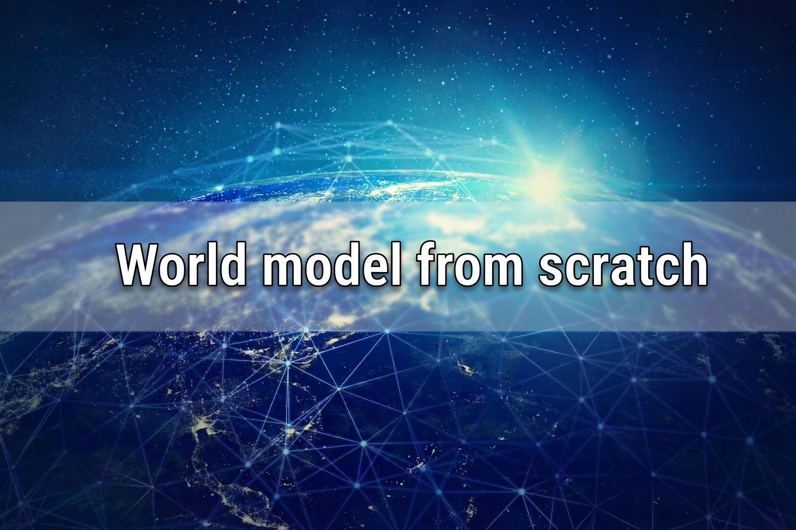
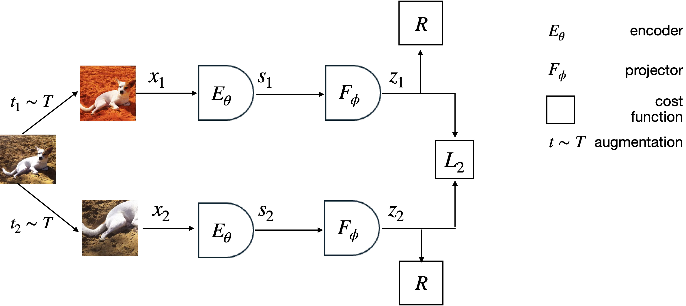
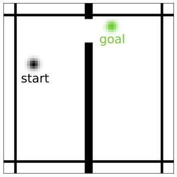
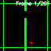

# 🌍🧠 World Models from Scratch

  

## 📝 Description

A short course on **world models**, the networks that learn how an environment evolves so a machine can *imagine* what happens next. Each chapter is built around one reference figure from **Meta FAIR**, and carries one idea.

---

## 📚 Course outline

| # | Chapter | The idea |
|---|---|---|
| 1 | [What is a world model?](#-1-what-is-a-world-model) | Learn the dynamics, not a reflex |
| 2 | [The vocabulary in one figure](#-2-the-vocabulary-in-one-figure) | Encoder, predictor, representation, cost |
| 3 | [Where do you predict?](#-3-where-do-you-predict) | Pixels, latents, tokens or representations |
| 4 | [Inside the training loop](#-4-inside-the-training-loop) | Multi-step prediction |
| 5 | [The collapse problem](#-5-the-collapse-problem) | Why a naive JEPA learns nothing |
| 6 | [Why rollouts drift](#-6-why-rollouts-drift) | Error accumulation |
| 7 | [Planning with a world model](#-7-planning-with-a-world-model) | The action is the output of a search |
| 8 | [Surprise as a signal](#-8-surprise-as-a-signal) | Energy as the machine looking time |
| 9 | [Everything in one diagram](#-9-everything-in-one-diagram) | A video JEPA, end to end |

---

## 🌍 1. What is a world model?

> **st+1 = f(st, at)**

A model-free agent (DQN, PPO) learns a reflex, from what it sees to what it does. A world model learns `f`, how the world moves on, and that unlocks **planning**, **training in imagination** and **detecting the impossible**.

🧠 <b>What <code>f</code> makes possible</b>

- **Plan** : roll out several futures and keep the best one.
- **Train without acting** : a policy learns inside the model's imagination (this is why DreamerV3 needs so little real experience).
- **Detect the impossible** : a future the model cannot predict breaks a rule it has learned.

---

## 🧩 2. The vocabulary in one figure

  
   Figure from <a href="https://github.com/facebookresearch/eb_jepa">facebookresearch/eb_jepa</a> (Meta FAIR, Apache 2.0)

Every figure of this course reuses these shapes. Panel **(b)** is the world model in its minimal form.

| Shape | Symbol | Meaning |
|---|---|---|
| 🔵 Dark blue trapezoid | **fθ** | The **encoder**, from raw input to representation |
| 🔷 Light blue half circle | **gφ** | The **predictor**, moves a representation forward in time |
| ⬛ Grey square | **z** | A **representation**, never an image |
| 🟧 Orange square | **C** | The **cost** (or energy), how wrong the prediction was |
| 🟠 Orange circle | **a** | A variable being **optimised** rather than given |

🔌 <b>The four panels, one by one</b>

- **(a) Image** : two views of one image, one encoder, a cost between them. No predictor yet, this is plain joint embedding learning.
- **(b) Video** : the predictor appears. It turns `z_t` into `ẑ_{t+1}`, compared to the true `z_{t+1}`.
- **(c) Action conditioned video** : the predictor also receives `a_t`. The model answers *"what happens if I do this?"*.
- **(d) Planning** : the actions turn orange. The model is no longer trained, it is **searched**.

---

## 🎨 3. Where do you predict?

| Family | The model predicts | Representative models | Pays for |
|---|---|---|---|
| **Pixel generative** | The image itself | World Models (2018), DIAMOND, Genie | Every pixel, even the unpredictable ones |
| **Latent generative** | A code decoded back to pixels | PlaNet, Dreamer V1 to V3 | Fewer pixels, but still pixels |
| **Token generative** | Discrete tokens of the frame | IRIS, STORM | Quantisation loss, long sequences |
| **Joint embedding (JEPA)** | A **representation**, never decoded | I-JEPA, V-JEPA 2, DINO-WM | Risk of collapse |

The exact future of a video is not determined (think of leaves in the wind), and a pixel loss turns that uncertainty into blur. Each family answers this problem by changing **what is predicted**.

📜 <b>The four families in detail</b>

- **Pixel generative** : World Models (Ha & Schmidhuber, 2018) chains a VAE, an MDN-RNN and a tiny controller, and trains an agent inside its own dream. DIAMOND (2024) predicts frames with a diffusion model. Genie (2024) even infers the actions on its own.
- **Latent generative** : the RSSM of PlaNet and Dreamer splits the state into a deterministic part and a stochastic part. DreamerV3 (2023) collects a diamond in Minecraft from scratch, with a policy trained 100 % in imagination.
- **Token generative** : IRIS (2023) quantises frames with a VQ-VAE, then a GPT style Transformer predicts the tokens.
- **JEPA** : no decoder at all. The model may ignore what it cannot predict, so what survives in the representation is what is predictable.

---

## 🔬 4. Inside the training loop

  
   Figure from <a href="https://github.com/facebookresearch/eb_jepa">facebookresearch/eb_jepa</a> (Meta FAIR, Apache 2.0)

Panel (b) unrolled over three frames of Moving MNIST. Training is **multi-step**, the predictor is also trained on its own chained predictions.

🔍 <b>Reading the figure</b>

- **The `R` boxes** are not a cost against anything. They are the regulariser that prevents collapse (chapter 5).
- **The three `L_2` costs** : `ŝ_1` against `s_1`, `ŝ_2` against `s_2`, and `ŝ_2` predicted from `s_0` through two predictor steps against the same `s_2`.
- **The projection** : costs are computed after an MLP projector, another anti-collapse trick borrowed from SimSiam and BYOL.

---

## 💥 5. The collapse problem

  
   Figure from <a href="https://github.com/facebookresearch/eb_jepa">facebookresearch/eb_jepa</a> (Meta FAIR, Apache 2.0)

Trained on `‖ŝ − s‖²` alone, a JEPA maps every input to the same vector and reaches zero loss while learning nothing. The `R` boxes exist to forbid this.

🛡️ <b>The three anti-collapse guards</b>

- **Asymmetry** : the target branch is an EMA copy of the encoder with a stop-gradient, so it cannot move to meet the prediction.
- **VICReg** : a variance term keeps each dimension alive, a covariance term stops dimensions from copying each other.
- **Energy view** : the loss only pushes energy down on real pairs. A proper energy-based model also needs to push it up elsewhere.

To detect collapse, track the **standard deviation of the representations across the batch**. When it heads to zero, the model is collapsing, whatever the loss says.

---

## 📉 6. Why rollouts drift

  
   Figure from <a href="https://github.com/facebookresearch/eb_jepa">facebookresearch/eb_jepa</a> (Meta FAIR, Apache 2.0)

Row 2 predicts one step at a time and stays sharp. Row 3 feeds its own predictions back in, and the digits smear, this is **error accumulation**.

📝 <b>Notes</b>

- The model has **no decoder**. One was trained afterwards only to make the representations visible, so the blur is information lost in the representation itself.
- Error accumulation caps how far ahead a world model can be trusted. In my [Snake World Model](https://github.com/Thibault-GAREL/AI_snake_world_model_version), planning quality peaked at a horizon of **5 steps**.

---

## 🎮 7. Planning with a world model

  
   Figure from <a href="https://github.com/facebookresearch/eb_jepa">facebookresearch/eb_jepa</a> (Meta FAIR, Apache 2.0)

At plan time nothing is trained. The actions become the unknowns, and the model searches for the sequence whose imagined end state is closest to the goal.

  
  
   The Two Rooms environment and an agent reaching the goal by planning only. Figures from <a href="https://github.com/facebookresearch/eb_jepa">facebookresearch/eb_jepa</a> (Meta FAIR, Apache 2.0)

The same recipe scales to a real robot arm, and the distance to the goal in representation space really goes down as the episode runs.

  
  
   Figures from <a href="https://github.com/facebookresearch/jepa-wms">facebookresearch/jepa-wms</a> (Meta FAIR, CC BY-NC 4.0)

---

## 😲 8. Surprise as a signal

  

Planning **minimises** the energy. Here the model only watches, and the moments where the energy **spikes** are the moments where a learned law was broken, exactly like the looking time used to test infants.

🧪 <b>IntPhys 2, the benchmark built on this protocol</b>

[IntPhys 2](https://github.com/facebookresearch/IntPhys2) shows quadruplets of videos, two possible and two impossible, and tests four principles infants acquire in their first year.

| Principle | Broken when |
|---|---|
| 🧱 **Permanence** | An object stops existing when hidden |
| 🎨 **Immutability** | An object changes shape or colour |
| 🌊 **Continuity** | An object teleports instead of moving |
| 🚧 **Solidity** | Two solid objects pass through each other |

V-JEPA reached **98 % on IntPhys v1** with no task specific training. On IntPhys 2, current video models and VLMs are still around **50 %**, pure chance.

---

## 🧭 9. Everything in one diagram

  

A video JEPA used as a surprise detector, with every piece of the course in place : encoder, predictor, EMA target, regulariser and energy.

---

## 📖 Inspiration / Sources

The figures in `assets/fair_figures/` are **not mine**. They come from Meta FAIR and are reproduced for teaching, with attribution, under their own licences (details in [`ATTRIBUTION.md`](assets/fair_figures/ATTRIBUTION.md)).
- 💻 [facebookresearch/eb_jepa](https://github.com/facebookresearch/eb_jepa), the energy-based JEPA tutorial (Apache 2.0)
- 💻 [facebookresearch/jepa-wms](https://github.com/facebookresearch/jepa-wms), JEPA world models for planning (CC BY-NC 4.0)

📄 <b>Papers</b>

- 📄 [World Models](https://arxiv.org/abs/1803.10122) (Ha & Schmidhuber, 2018)
- 📄 [Mastering Diverse Domains through World Models](https://arxiv.org/abs/2301.04104) (DreamerV3, 2023)
- 📄 [Transformers are Sample-Efficient World Models](https://arxiv.org/abs/2209.00588) (IRIS, 2023)
- 📄 [Diffusion for World Modeling: Visual Details Matter in Atari](https://arxiv.org/abs/2405.12399) (DIAMOND, 2024)
- 📄 [A Path Towards Autonomous Machine Intelligence](https://openreview.net/forum?id=BZ5a1r-kVsf) (LeCun, 2022)
- 📄 [Intuitive physics understanding emerges from self-supervised pretraining on natural videos](https://arxiv.org/abs/2502.11831) (Garrido, Ballas & LeCun, 2025)
- 📄 [IntPhys 2: Benchmarking Intuitive Physics Understanding in Complex Synthetic Environments](https://arxiv.org/abs/2506.09849) (2025)

Related work of mine :
- 🐍 [Snake World Model](https://github.com/Thibault-GAREL/AI_snake_world_model_version), a JEPA that plays Snake by planning only
- 🤖 [Language Models from Scratch](https://github.com/Thibault-GAREL/Language_Models), the same "build it and explain it" approach for Transformers

Code created by me 😎, Thibault GAREL - [Github](https://github.com/Thibault-GAREL)
